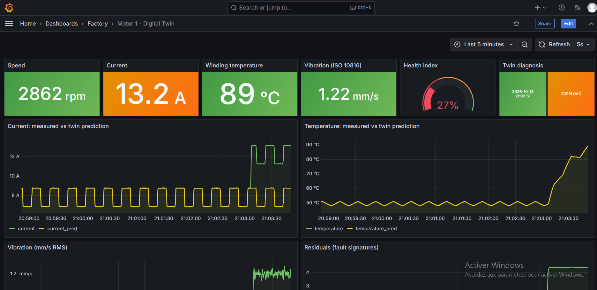
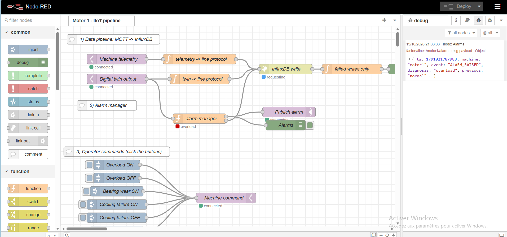
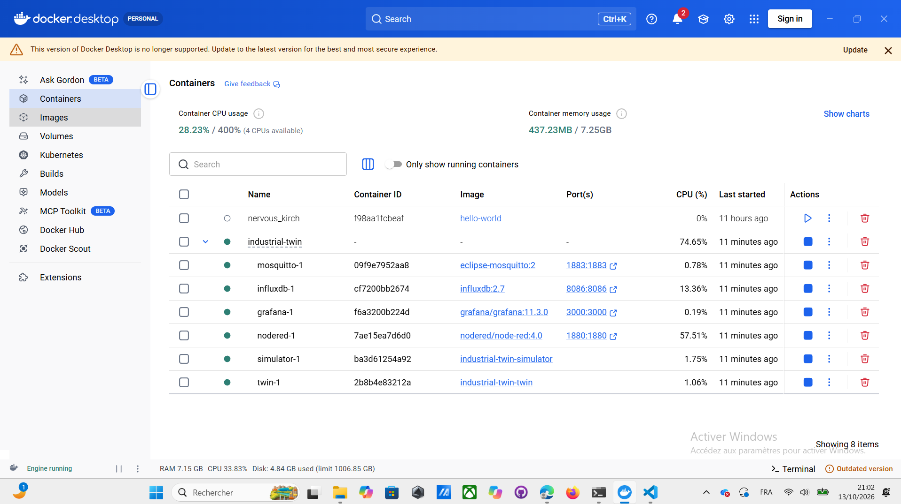

# Industrial Digital Twin: IIoT stack (MQTT · Node-RED · InfluxDB · Grafana)

Real-time digital twin of a conveyor drive, built on the standard Industry 4.0 stack.
No hardware needed: a physics simulator plays the machine.



## Architecture
```
[simulator]  physics plant (DC motor + PI control + thermal + bearing wear)
     │  MQTT  factory/line1/motor1/telemetry  (20 Hz JSON)
     ▼
[mosquitto]  MQTT broker ───────────────►  [twin]  nominal model → residuals → diagnosis
     ▲                                        │  MQTT  factory/line1/motor1/twin
     │  cmd (fault injection)                 ▼
[node-red]  MQTT → line protocol → InfluxDB  ·  alarm manager  ·  operator buttons
     ▼
[influxdb]  time-series storage (bucket "motor")
     ▼
[grafana]   live dashboard "Motor 1 - Digital Twin"
```

## MQTT topics (ISA-95 style: site/line/machine)
| Topic | Producer | Content |
|---|---|---|
| `factory/line1/motor1/telemetry` | simulator | voltage, current, speed, temperature, vibration |
| `factory/line1/motor1/twin` | twin | predictions, residuals, health index, diagnosis |
| `factory/line1/motor1/alarm` | Node-RED | ALARM_RAISED / ALARM_CLEARED events (retained) |
| `factory/line1/motor1/cmd` | Node-RED | fault injection / reset |

## Run
Requirement: **Docker Desktop**.
```bash
copy .env.example .env      # Windows (Linux/Mac: cp .env.example .env)
docker compose up -d --build
```
| Service | URL | Login |
|---|---|---|
| Grafana | http://localhost:3000 | admin / admin |
| Node-RED | http://localhost:1880 | none |
| InfluxDB | http://localhost:8086 | admin / admin12345 |

1. Open Grafana → Dashboards → Factory → **Motor 1 - Digital Twin**.
2. Open Node-RED → click the buttons of the inject nodes (Overload ON, Cooling failure ON...).
3. Watch the twin detect the fault in Grafana and the alarm in the Node-RED debug panel.

Stop: `docker compose down` (add `-v` to delete stored data).

## Faults and signatures
| Fault | Physical effect | Twin signature |
|---|---|---|
| Bearing wear | friction ↑, vibration ↑ | r_vib ↑ (+ r_current ↑) → thermal trip at 150 °C |
| Overload | unexpected load torque | r_current ↑, vibration normal |
| Cooling failure | thermal resistance ↑ | r_temp ↑, current normal |

## Next steps
- [ ] Grafana alert rules (email / Telegram) on health index < 40 %
- [ ] ML anomaly detection service (Isolation Forest) reading InfluxDB
- [ ] OPC UA server for the simulator (node-red-contrib-opcua)
- [ ] Several machines (motor2, motor3) + OEE dashboard

## Screenshots
| Node-RED flow | Docker containers |
|---|---|
|  |  |

## Skills demonstrated
Physics-based modelling (DC motor, PI control, thermal model) - digital twin and residual-based fault diagnosis - IIoT architecture (MQTT, ISA-95 topics) - Node-RED - InfluxDB / Flux - Grafana - Docker Compose - Python

## Author
Salsabil Hachem - Mechatronics Engineer (ENISo, Tunisia)

## License
MIT
